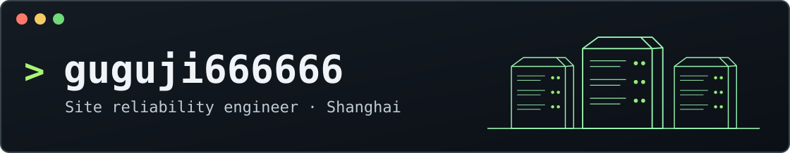

**English** · [简体中文](./README.zh-CN.md)

## I have experience in

- Deploying services on GKE and troubleshooting failed rollouts.
- Investigating Defender alerts and resolving sign-in issues with Entra ID and MFA.
- Automating maintenance with Python and PowerShell, including dry runs and post-change checks.
- Reproducing authentication issues in a lab and writing troubleshooting guides for support teams.

## Skills in practice

| Area | Tools |
| --- | --- |
| **Cloud delivery** | `GKE` · `Terraform` · `Helm` · `Argo CD` |
| **Security & identity** | `Sentinel` · `KQL` · `Defender` · `Entra ID` |
| **Automation** | `Python` · `PowerShell` |

## Most-starred repositories

| Repository | What you'll find |
| --- | --- |
| [Active-Directoy-Lab](https://github.com/guguji666666/Active-Directoy-Lab) | PowerShell scripts for a Windows domain lab |
| [GJS-AAD-Auth](https://github.com/guguji666666/GJS-AAD-Auth) | Hybrid identity labs with Okta, single sign-on and MFA |
| [GJS-Sentinel-Tips](https://github.com/guguji666666/GJS-Sentinel-Tips) | Log integration and troubleshooting in Microsoft Sentinel |
| [GJS-MDC-Tips](https://github.com/guguji666666/GJS-MDC-Tips) | A deployment and configuration reference for Defender for Cloud |

## Project inquiries

I build Python automations and internal tools, and help collect and clean public data. If you have a project in mind, send me a sample input and the result you need.

[Contact me on X ↗](https://x.com/guguuj)
